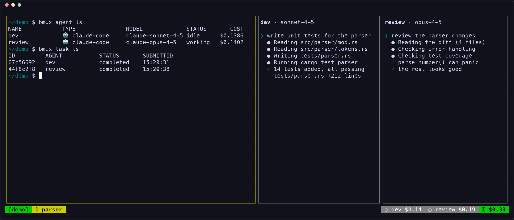
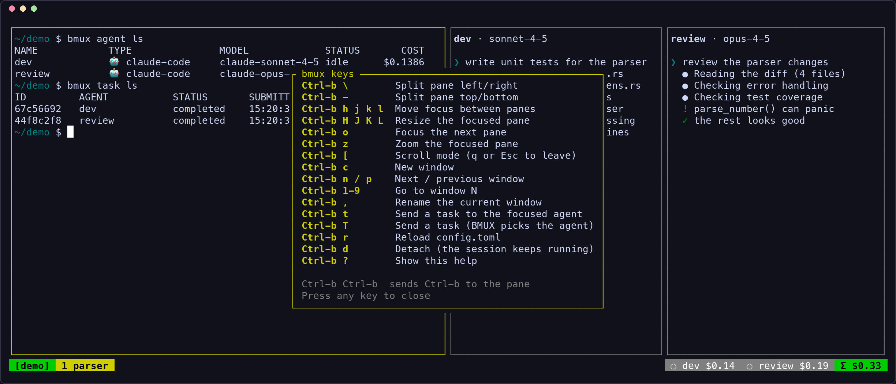

# BMUX

[](https://github.com/allanbrunobr/bmux/actions/workflows/ci.yml)
[](LICENSE)


A terminal multiplexer for running AI coding agents side by side.

BMUX works like tmux: sessions, windows, panes, detach and attach. It also knows which panes run agents. You can send them tasks from the command line or from the keyboard, queue work per agent, share context between agents, chain agents in YAML workflows and see what each agent costs on the status bar.



<sub>A shell pane and two agent panes. The agents in this screenshot are a scripted stand-in that writes Claude Code transcripts, so the costs are illustrative. With Claude Code, BMUX reads the same transcripts.</sub>

## Contents

- [Status](#status)
- [Install](#install)
- [Quick start](#quick-start)
- [Key bindings](#key-bindings)
- [Command reference](#command-reference)
- [Agents and cost tracking](#agents-and-cost-tracking)
- [Tasks](#tasks)
- [Workflows](#workflows)
- [Configuration](#configuration)
- [Security model](#security-model)
- [Documentation](#documentation)
- [Development](#development)
- [License](#license)

## Status

BMUX is version 0.1.0 and runs on macOS and Linux. It is usable day to day, but expect rough edges.

What works:

- tmux-style sessions with a background daemon, panes, windows, zoom, scrollback, detach and attach.
- Agents in panes: Claude Code, OpenCode, pi, Gemini CLI, a plain shell, or any CLI you configure.
- Tasks: send to one agent, or let BMUX pick an idle agent. Each agent has its own queue.
- Live token and cost tracking for Claude Code, shown on the status bar and in `bmux agent list`.
- A shared key-value context store per session, and YAML workflows that pass one step's output to the next.
- A hardened daemon: HMAC-signed IPC, 0600 sockets, secrets passed by file descriptor, sandboxed agents and an audit log.

Known limits:

- Cost tracking and automatic task completion work only for Claude Code. BMUX gets both from the transcript that Claude Code writes. Other agents show no cost, and their tasks stay `active` until the agent reports a result over the IPC socket. No stock CLI does that yet.
- Costs are estimates at public list prices. They do not include discounts, batch pricing or subscription plans.
- Workflows send steps to agents that already run in the session. Start the agents first.
- No Windows support, and no prebuilt binaries or packages yet. Build from source.

## Install

You need a stable [Rust toolchain](https://rustup.rs) and a C compiler.

```bash
cargo install --locked --git https://github.com/allanbrunobr/bmux
```

Or build from a clone:

```bash
git clone https://github.com/allanbrunobr/bmux
cd bmux
cargo build --release
./target/release/bmux --version
```

Install the agent CLIs that you want to use (for example `claude`) and make sure that they are on your `PATH`.

> The `bmux` crate on crates.io is a different project. Do not use `cargo install bmux`.

## Quick start

```bash
bmux new work                          # start session "work" and attach to it
```

In the shell inside the session (or from any other terminal):

```bash
bmux agent spawn claude --name dev     # open Claude Code in a new pane
bmux task send dev "write unit tests for the parser"
bmux agent list                        # status, model and cost of each agent
```

Press `Ctrl-b d` to detach. The session keeps running in the background. Use `bmux attach work` (or just `bmux attach` when only one session runs) to come back, and `bmux kill work` to end it.

Inside a session, commands find the session from `BMUX_SESSION`. Outside a session, BMUX uses the only running session, or you pass `-s <name>`.

`bmux` with no arguments opens a plain multiplexer in the current process: panes and windows, but no daemon, so no detach and no agents.

## Key bindings

The prefix is `Ctrl-b`. You can change it with `[tui] prefix_key`. Press `Ctrl-b ?` in a session to show this list.



| Keys | Action |
|---|---|
| `Ctrl-b \` / `Ctrl-b -` | Split the pane left/right or top/bottom |
| `Ctrl-b h j k l` | Move focus between panes |
| `Ctrl-b H J K L` | Resize the focused pane |
| `Ctrl-b o` | Focus the next pane |
| `Ctrl-b z` | Zoom the focused pane |
| `Ctrl-b [` | Scroll mode (`q` or `Esc` to leave) |
| `Ctrl-b c` | New window |
| `Ctrl-b n` / `Ctrl-b p` | Next or previous window |
| `Ctrl-b 1`–`9` | Go to window N |
| `Ctrl-b ,` | Rename the current window |
| `Ctrl-b t` | Send a task to the agent in the focused pane |
| `Ctrl-b T` | Send a task and let BMUX pick the agent |
| `Ctrl-b r` | Reload `config.toml` |
| `Ctrl-b d` | Detach |
| `Ctrl-b ?` | Show the key bindings |
| `Ctrl-b Ctrl-b` | Send `Ctrl-b` to the pane |

## Command reference

| Command | Description |
|---|---|
| `bmux new [NAME]` | Start a session and attach. The default name is the first free number. |
| `bmux attach [NAME]` | Attach to a session. NAME can be omitted when only one session runs. |
| `bmux ls` | List sessions |
| `bmux kill <NAME>` | End a session and all its processes |
| `bmux agent spawn [TYPE] --name <NAME> [--model <MODEL>]` | Start an agent in a new pane. TYPE defaults to `[agents] default_type`. |
| `bmux agent list` / `status <NAME>` / `kill <NAME>` | Inspect or stop agents |
| `bmux task send <AGENT> <TEXT>...` | Send a task to an agent |
| `bmux task send --auto <TEXT>...` | Let BMUX pick an idle agent (`--model` prefers a model) |
| `bmux task list` / `status <ID>` / `cancel <ID>` | Inspect or cancel tasks. Only queued tasks can be cancelled. |
| `bmux context set <KEY> <VALUE>` / `get` / `list` / `dump` | Read and write the session's shared context |
| `bmux workflow run <FILE> [--input <JSON>] [--dry-run]` | Run a workflow, or only validate it and print the plan |
| `bmux workflow status <RUN_ID>` | Show a workflow run as JSON |
| `bmux workflow list` | List workflows in `~/.config/bmux/workflows/` |
| `bmux config show` / `validate` / `reload` | Show or check the configuration, or reload it in a running session |
| `bmux data purge` | Delete local BMUX data: audit logs, context and session files |

Every command that talks to a session accepts `-s, --session <NAME>`. Run `bmux <command> --help` for details, or read the [man page](docs/man/bmux.1).

## Agents and cost tracking

Built-in agent types:

| Type | Binary |
|---|---|
| `claude-code` (alias `claude`) | `claude` |
| `opencode` | `opencode` |
| `pi` | `pi` |
| `gemini` | `gemini` |
| `shell` | your shell |

You can add other CLIs as custom types in `config.toml`. Each agent runs in its own pane with a minimal environment. The pane title shows the agent name and model.

**How cost tracking works.** BMUX starts Claude Code with a known `--session-id` and follows the transcript at `~/.claude/projects/<project>/<session-id>.jsonl` (it also checks `$CLAUDE_CONFIG_DIR/projects`). Each assistant message in the transcript has a `usage` block. BMUX adds up input, output and prompt-cache tokens and prices them with the list price of the model family (Opus, Sonnet or Haiku). If BMUX does not know a model, it uses the agent's `cost_per_1k_tokens`.

The status bar shows one badge per agent: `●` working, `○` idle, `◐` waiting, `✗` error. Each badge shows the agent's cost, and `Σ` shows the session total. Agents without cost tracking show `—`. The same transcript tells BMUX when Claude Code finishes a turn, so the task becomes `completed` and the next queued task for that agent starts.

## Tasks

- `bmux task send dev "..."` types the task into the agent's pane. If the agent is busy, the task waits in that agent's queue.
- `bmux task send --auto "..."` picks an idle agent. Cheaper agents and agents that have been idle longer win. When all agents are busy, the task is queued until one is free, or until it times out.
- Task text must be one line. BMUX removes secrets that it recognizes from the text before delivery and writes the delivery to the audit log.
- In the TUI, `Ctrl-b t` asks for a task for the agent in the focused pane. `Ctrl-b T` asks for a task and routes it automatically.

## Workflows

A workflow is a DAG of steps in YAML. Each step goes to an agent that runs in the session. Steps run when their dependencies finish. Steps without dependencies run in parallel.

```yaml
name: feature
version: "1"
agents:
  dev:
    type: claude-code
  review:
    type: claude-code
steps:
  - id: implement
    agent: dev
    prompt: "Implement {{ input.feature }}"
  - id: review
    agent: review
    depends_on: [implement]
    prompt: "Review this change: {{ context.workflow:implement:output }}"
```

```bash
bmux agent spawn claude --name dev
bmux agent spawn claude --name review
bmux workflow run feature.yaml --dry-run
bmux workflow run feature.yaml --input '{"feature": "a CSV parser"}'
bmux workflow status <run_id>
```

- `{{ input.KEY }}` comes from `--input`.
- `{{ context.KEY }}` reads the context store.
- `{{ context.workflow:<step>:output }}` is the final reply of an earlier step in the same run.
- A step can set `context_key` to store its output under a key of your choice, and `timeout_seconds` to limit its run time (default: one hour).

## Configuration

BMUX reads `~/.config/bmux/config.toml` (or `$XDG_CONFIG_HOME/bmux/config.toml`). Every field is optional. [`.config/bmux/config.toml.example`](.config/bmux/config.toml.example) documents all of them.

```toml
[tui]
prefix_key = "ctrl-b"        # ctrl-<letter>
# default_shell = "/bin/zsh" # default: $SHELL, then /bin/sh
status_bar = true

[agents]
default_type = "claude-code"

[agents.claude_code]
binary = "claude"

# A custom agent: `bmux agent spawn my-agent --name x`
[agents.my-agent]
binary = "my-agent-cli"
model = "llama-3.1-70b"
cost_per_1k_tokens = 0.0001
args = ["--mode", "interactive"]

[security]
sandbox = "landlock"         # "none" turns the agent sandbox off

[audit]
enabled = true
```

`bmux config validate` checks the file. `bmux config reload` (or `Ctrl-b r`) applies it to a running session.

### Secrets

Put API keys in `~/.config/bmux/secrets.toml`. BMUX refuses to read the file unless its mode is `0600`.

```toml
[keys]
anthropic = "sk-ant-..."
```

BMUX does not put keys in the agent's environment. It passes the first available key (`anthropic`, `openai` or `google`) on an inherited file descriptor and sets `BMUX_SECRET_FD` to its number. This is for agents that read that descriptor. Stock CLIs such as Claude Code keep using their own login. BMUX also removes known key values from task text and from audit log entries.

## Security model

Agents run with your user account, so BMUX tries to limit what they and other local processes can do:

- **Signed IPC.** The CLI, the TUI and the daemon sign every message with a per-session HMAC key. The agent message bus uses its own key, which agents get by file descriptor.
- **Private sockets.** Session sockets and metadata files are `0600`.
- **Clean environment.** BMUX clears the environment before it starts an agent, so tokens and keys in your shell do not leak into it. The agent gets `TERM`, the `BMUX_*` variables and the basic variables that the PTY layer sets, such as `HOME` and `PATH`. Commands are built as argument lists, never as shell strings.
- **Sandbox.** On macOS, agents run under `sandbox-exec` with a Seatbelt profile scoped to the project directory. On Linux, they run under bubblewrap (`bwrap`) when it is installed. Set `sandbox = "none"` to turn it off. `shell` panes are never sandboxed.
- **Audit log.** Agent spawns, task deliveries and context writes go to an append-only audit log, with secrets removed. `bmux data purge` deletes it.
- **Permission prompts stay on.** BMUX starts Claude Code with `--dangerously-skip-permissions` only if you set `allow_dangerous_permissions = true` in `[security]`.

The [ADRs](docs/adr/) explain these decisions.

## Documentation

- [Architecture](docs/architecture.md): runtime components, request paths and module map
- [Architecture decision records](docs/adr/)
- [Man page](docs/man/bmux.1): `man ./docs/man/bmux.1`
- [Contributing](CONTRIBUTING.md)

## Development

```bash
cargo build
cargo test
cargo clippy -- -D warnings
cargo fmt --check
```

CI runs these on Ubuntu and macOS and cross-compiles for four targets.

## License

[MIT](LICENSE)
